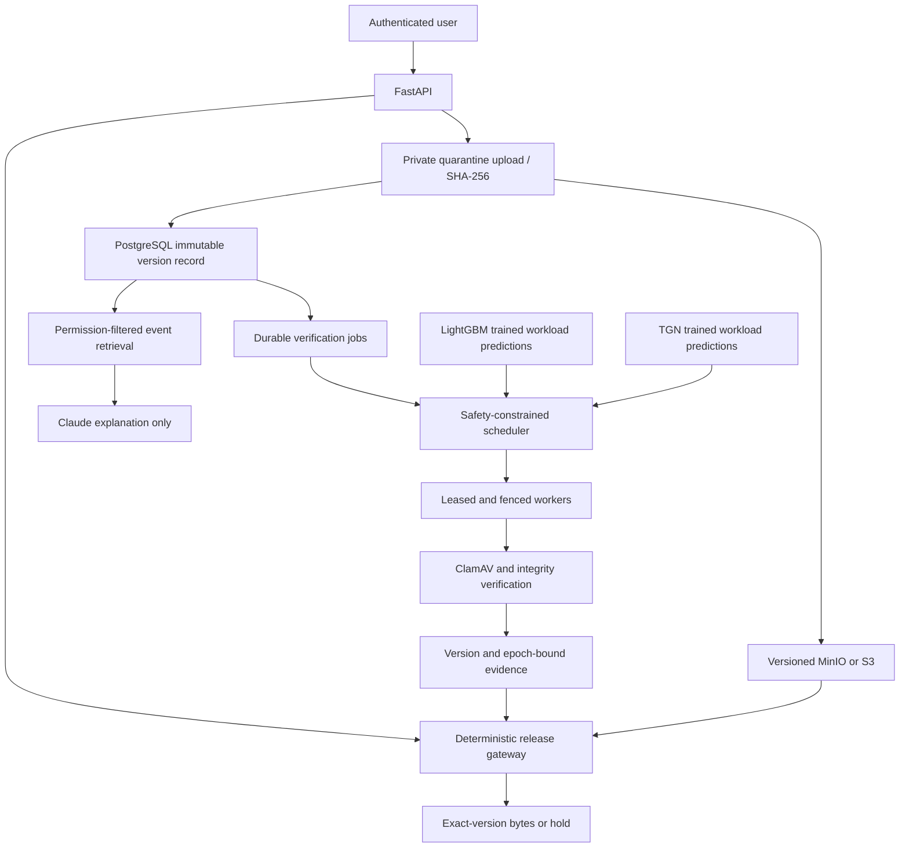

# System architecture and release protocol

## Boundaries

The React/TypeScript frontend uses React Router, TanStack Query, React Hook Form and Zod. Tailwind is available alongside a restrained CSS design system. All pages request FastAPI APIs. Query polling exposes real queue and security state; no fixture counts are injected into the application.

FastAPI owns identity, tenant/file authorization, upload validation, evidence queries, release decisions, graph inspection, experiment retrieval and read-only explanations. PostgreSQL is authoritative. Redis provides rate counters. PostgreSQL row locks, durable job rows and expiring leases implement the comparable durable job framework requested instead of Celery. MinIO/S3 stores private objects with versioning enabled. ClamAV receives exact object bytes through INSTREAM.

Services are clean Python modules within one deployable package rather than independent network microservices: `storage`, `scanner`, `domain` (evidence/release), `scheduling`, `worker`, `assistant`, and `predict`. Splitting them into network services would add failure modes before validation.

## Identity and tenant model

Opaque random session tokens are hashed in the database. Argon2id hashes passwords. Cookies are HttpOnly, SameSite=Strict, Secure in production. Mutations require matching Origin plus a per-session CSRF token. Refresh rotates the session token and CSRF secret, with 30-minute rolling and 24-hour absolute expiry. The implementation uses server-side sessions rather than JWTs; there is no JWT signing key to configure. Each public registration creates an isolated tenant with a researcher administrator. Only that role can create same-tenant members and view research operations.

## Upload and evidence

Supported formats are UTF-8 TXT/CSV/JSON, signature-checked PDF/PNG/JPEG. Uploads stream to a bounded temporary private file while computing SHA-256. Content type inspection currently materializes the bounded file in memory. The store generates a physical object-version ID; this is distinct from the logical file ID, application version UUID and monotonically increasing version number. Version rows bind tenant, key, object-store version, digest, byte size and MIME type.

New versions start PENDING and receive a deduplicated scan+integrity job. Claimed jobs move their matching version to VERIFYING. A clean exact-object scan plus matching protected baseline creates APPROVED evidence; malware or mismatched bytes produces QUARANTINED. Scanner exceptions retry, eventually FAILED. Approval is a policy-valid scan result, not proof of malware absence.

Evidence is stored in separate scan and integrity tables. Scan evidence includes engine/signature version string, epoch, generation, object version, SHA-256, duration, creation and expiry. Integrity evidence records the protected baseline and observed digest. Typed graph edges link version → scan, version → integrity and policy → scan, representing these dependencies. Current ACLs are separate records.

Workers use random lease fencing tokens. Completion only applies while the job is RUNNING, the token is current, the lease is unexpired and version generation and policy epoch still match. A late V1 result can update only V1, never V2. Policy advancement invalidates non-quarantined versions; periodic reconciliation detects expired evidence, coalesces missing work and recovers expired worker leases. ACL revocation does not rescan content.

## Release invariant

Release requires all of the following:

1. The authenticated user has current read permission in the file's tenant, or owns it.
2. The logical file is not deleted, and the requested version is the current authorized target.
3. The exact version is APPROVED, with CLEAN scan evidence matching digest, physical object version, current generation and policy epoch.
4. Integrity evidence matches the immutable protected digest and current generation.
5. Both evidence records are fresh at the decision.
6. Re-reading the pinned object and hashing it still matches the protected digest.

Older versions remain visible in history but are not release targets under the initial policy. Historical-version grants would require a separate explicit target policy.

The gateway and ACL mutation endpoints lock the same file row. The gateway also locks the current policy row, reads the exact immutable object, validates its bytes, and commits its audit decision. **The transaction commit with those locks held is the authorization linearization point.** Revocation committed before that decision must deny a new authorization. Revocation that commits afterward does not retract a response already authorized. There are no presigned download URLs; response bytes are served by FastAPI. Already downloaded bytes cannot be revoked.

## Queue and scheduler

Jobs persist creation/deadline/cost/attempts/epoch/generation/worker/lease/terminal timestamps and errors. Idempotency is `(version, epoch, generation, type)`. Retry delay is exponential, with a finite attempt limit and DEAD terminal state. Reconciliation and claims use a global PostgreSQL transaction advisory lock; candidates use SKIP LOCKED. This favors correctness over high throughput. Reconciliation locks file rows in sorted order before updating recovery state. Production concurrency still needs stress testing.

FIFO, EDF and rule-based ranking operate without ML. Deadline urgency and age-based starvation prevention precede each strategy's ranking. Global worker and per-tenant capacities limit leases. Cross-tenant selection compares each tenant's best eligible job with EDF and aging. ML ranks `(1 + demand) / duration`, bounded against invalid/zero durations. Missing dependencies, checkpoints or invalid predictions select EDF fallback, recorded in the decision. Prediction code receives data read access through the worker session but exposes no evidence mutation API; this is process-level separation, not a hardened separate ML service identity.

## Temporal graph and explanations

Graph event IDs and typed entity IDs are persisted UUID-based identifiers, independent of query order. API graph queries are tenant-scoped and bounded to 150 edges (UI defaults to 80), with exact-node and historical cutoff filters. Graph display is an inspection aid. The ML module uses causal bounded recent neighborhoods, not the visualization.

RAG uses authorized SQL filtering and BM25 over controlled security event fields. File names, file bytes, tokens, credentials and arbitrary metadata are excluded. Current permission is checked again after Claude returns. Unsupported citations cause a fallback; token accounting records actual API usage. Event timestamps are exposed rather than presenting old events as current evidence. Full claim entailment and adversarial RAG evaluations remain future work.
